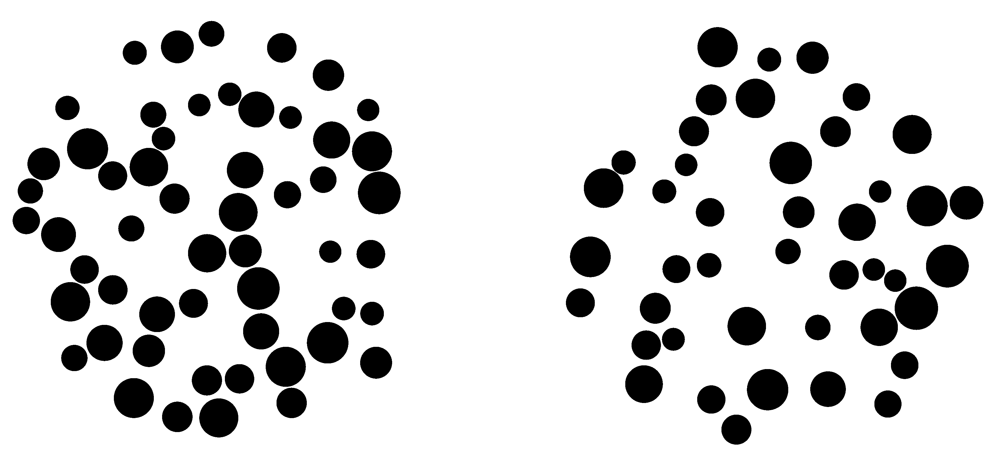

```{r}
#| include: false
# Every result shown here is computed by prepare_results.R and read from
# its results directory. Nothing in this document takes more than seconds.
# PLYMOUTH_RESULTS=results-test renders from the quick test run instead.
library(tidyverse)
res_dir <- Sys.getenv("PLYMOUTH_RESULTS", "results")
read_result <- function(name) readRDS(file.path(res_dir, str_c(name, ".rds")))
beh <- read_result("behaviour")
erp <- read_result("erp")
raw <- read_result("raw")
items <- read_result("items")
models <- read_result("models")

accent <- "#BE0000"
blue <- "#1F4E99"
electrodes <- c("POz", "Oz", "Pz", "PO7", "PO8")
theme_slide <- theme_minimal(base_size = 16) +
  theme(panel.grid.minor = element_blank(), legend.position = "top",
        legend.title = element_blank())
xlab_time <- "Time from stimulus onset (ms)"
fac <- function(d) mutate(d, electrode = factor(electrode, levels = electrodes))

# Runs of consecutive timepoints, after stimulus onset, where a band
# excludes zero, as "a to b ms" strings.
windows <- function(time, lo, hi, min_len = 3) {
  excl <- (lo > 0 | hi < 0) & time > 0
  r <- rle(excl)
  ends <- cumsum(r$lengths)
  starts <- ends - r$lengths + 1
  keep <- r$values & r$lengths >= min_len
  tibble(start = round(time[starts[keep]]), end = round(time[ends[keep]]),
         sign = sign(lo[starts[keep]] + hi[starts[keep]]))
}

# Shade windows where a band excludes zero.
excl_rects <- function(d) {
  d |> filter(q5 > 0 | q95 < 0) |>
    geom_rect(mapping = aes(xmin = time - 4, xmax = time + 4, ymin = -Inf, ymax = Inf),
              fill = "gold", alpha = 0.3, inherit.aes = FALSE)
}

n_subj_beh <- nrow(beh$by_subject)
n_subj_eeg <- n_distinct(models$a_subj$subject[models$a_subj$electrode == "POz"])
```

## What this part of the talk shows

Three questions about the neural signature of the approximate number system (ANS), using the adult EEG data.

- Is the expected signature there: P1, N1 and P2p at posterior electrodes?
- Does it differ between people with more and less precise number sense (ANS acuity)?
- Does it change with the difficulty of the comparison (numerical ratio)?

All results are preliminary, work in progress with a new method.

::: {.notes}
The three questions are answered with the adult data only. The child data is being preprocessed separately.
:::

## The task

::::: {.columns}
:::: {.column width="55%"}

::::
:::: {.column width="45%"}
Which side has more dots?

- `r n_subj_beh` adults, `r scales::comma(beh$n_trials)` trials
- Ratios of larger to smaller from `r sprintf("%.2f", min(beh$curves$ratio))` to `r sprintf("%.2f", max(beh$curves$ratio))`, so every comparison is fairly hard
- 64-channel EEG, time-locked to the onset of the two arrays
::::
:::::

## A new way to analyse ERPs

Standard ERP analysis averages over trials and people, and compares conditions at chosen time windows.

Instead, we model every single trial's waveform directly, as a smooth curve made of simple building blocks (basis functions).

- A population waveform, shared by everyone
- Each person's own deviation from it, a whole waveform shape
- Each trial's deviation from that person's waveform
- Effects of predictors, such as a person's accuracy or a trial's difficulty, as whole curves over time

This is multilevel (mixed-effects) regression, with waveforms in place of single numbers, fitted with Bayesian methods.

::: {.notes}
Technically, each waveform is a weighted sum of Gaussian radial basis functions, with penalised (smoothness) priors on the weights, as in generalised additive models, and autocorrelated (AR(2)) noise. Subject and trial deviations are integrated out exactly, so the model fits all 8000 or so trials at once.
:::

## Behaviour: accuracy depends on ratio

```{r}
#| fig-width: 10
#| fig-height: 5.2
mean_curve <- beh$curves |> summarise(p = mean(p), .by = ratio)
ggplot(beh$curves, aes(ratio, p)) +
  geom_line(aes(group = subject), colour = "grey50", alpha = 0.35) +
  geom_line(data = mean_curve, colour = accent, linewidth = 1.5) +
  scale_y_continuous(labels = scales::percent) +
  labs(x = "Ratio of larger to smaller array", y = "Accuracy") +
  theme_slide
```

```{r}
#| include: false
bins <- beh$by_subject_bin |>
  summarise(accuracy = mean(accuracy), median_rt = mean(median_rt), .by = ratio_bin) |>
  arrange(ratio_bin)
```

Grey, each participant. Red, the average. Accuracy rises from `r round(100 * first(bins$accuracy))`% in the hardest fifth of trials to `r round(100 * last(bins$accuracy))`% in the easiest, and the slope is positive in `r sum(beh$slopes$slope > 0)` of `r nrow(beh$slopes)` participants.

## Behaviour: people differ in acuity

```{r}
#| fig-width: 10
#| fig-height: 5.2
ggplot(beh$by_subject, aes(accuracy, median_rt)) +
  geom_point(size = 3, colour = blue, alpha = 0.8) +
  scale_x_continuous(labels = scales::percent) +
  labs(x = "Participant's overall accuracy", y = "Participant's median response time (s)") +
  theme_slide
```

Overall accuracy ranges from `r round(100 * min(beh$by_subject$accuracy))`% to `r round(100 * max(beh$by_subject$accuracy))`%.
Accuracy is our measure of each person's ANS acuity.
Everyone saw the same ratios, so accuracy carries the same information as the Weber fraction.

## Grand-average ERPs

```{r}
#| fig-width: 10
#| fig-height: 5.6
sel <- c("AF3", "AFz", "AF4", "C3", "Cz", "C4", "PO7", "POz", "PO8", "P7", "Pz", "P8")
erp$grand |>
  filter(channel %in% sel) |>
  mutate(channel = factor(channel, levels = sel)) |>
  ggplot(aes(time, voltage)) +
  geom_hline(yintercept = 0, colour = "grey80") +
  geom_line() +
  facet_wrap(~channel, ncol = 6) +
  labs(x = xlab_time, y = "Voltage (µV)") +
  theme_minimal(base_size = 13)
```

Anterior (AF), central (C) and posterior (P, PO) electrodes.
The clear P1, N1 and P2p are at the posterior electrodes, where the ANS literature places them.

## Posterior electrodes, participant by participant

```{r}
#| fig-width: 11
#| fig-height: 4.6
ga <- erp$subject_avg |> summarise(voltage = mean(voltage), .by = c(channel, time))
erp$subject_avg |>
  mutate(channel = factor(channel, levels = electrodes)) |>
  ggplot(aes(time, voltage)) +
  geom_line(aes(group = subject), alpha = 0.15) +
  geom_line(data = ga |> mutate(channel = factor(channel, levels = electrodes)),
            colour = accent, linewidth = 1) +
  facet_wrap(~channel, nrow = 1) +
  labs(x = xlab_time, y = "Voltage (µV)") +
  theme_minimal(base_size = 14)
```

Black, each participant's average. Red, the grand average.
The components are shared, but their size and timing vary a great deal between people.

## The model recovers the signature

```{r}
#| fig-width: 11
#| fig-height: 4.8
models$population |> fac() |>
  ggplot(aes(time)) +
  geom_hline(yintercept = 0, colour = "grey85") +
  geom_ribbon(aes(ymin = q5, ymax = q95), fill = accent, alpha = 0.3) +
  geom_line(aes(y = data), colour = "grey30") +
  geom_line(aes(y = q50), colour = accent) +
  facet_wrap(~electrode, nrow = 1) +
  labs(x = xlab_time, y = "Voltage (µV)") +
  theme_minimal(base_size = 14)
```

Red, the model's population waveform with its 90% uncertainty band. Grey, the average of the participants' own averages.
The model captures P1, N1, P2p and the later positivity at every electrode.

## The model captures each individual

```{r}
#| fig-width: 11
#| fig-height: 5
show <- models$a_subj |> filter(electrode == "POz") |> arrange(a) |>
  slice(round(seq(1, n(), length.out = 6))) |> pull(subject)
obs <- erp$subject_avg |> filter(channel == "POz", subject %in% show)
fit <- models$subjects |> filter(electrode == "POz", subject %in% show)
ggplot(obs, aes(time, voltage)) +
  geom_line(colour = "grey50") +
  geom_line(data = fit, aes(y = fitted), colour = accent, linewidth = 1) +
  facet_wrap(~ factor(subject, levels = show), nrow = 2) +
  labs(x = xlab_time, y = "Voltage (µV)") +
  theme_minimal(base_size = 14)
```

Six participants at POz, from lowest to highest accuracy. Grey, the participant's average. Red, the model's estimate of their waveform, which follows each person's components while smoothing over noise.

## Where do people differ?

```{r}
#| fig-width: 11
#| fig-height: 4.8
models$between_sd |> fac() |>
  ggplot(aes(time)) +
  geom_ribbon(aes(ymin = q5, ymax = q95), fill = blue, alpha = 0.3) +
  geom_line(aes(y = q50), colour = blue) +
  facet_wrap(~electrode, nrow = 1) +
  labs(x = xlab_time, y = "Between-person SD (µV)") +
  theme_minimal(base_size = 14)
```

```{r}
#| include: false
peaks <- models$between_sd |> filter(electrode == "POz", time > 0) |>
  slice_max(q50, n = 1)
```

How much the waveform differs between people, over time.
It is near zero before the stimulus and largest at the N1 and P2p, peaking at about `r round(peaks$q50, 1)` µV at POz.
Individual differences are concentrated in exactly the components of interest.

## Acuity: higher-accuracy people have a larger P2p

```{r}
#| fig-width: 11
#| fig-height: 4.8
pa <- models$predicted_accuracy |> fac() |>
  mutate(level = sprintf("%s accuracy (%.0f%%)", str_to_sentence(level), 100 * accuracy))
ggplot(pa, aes(time, colour = level, fill = level)) +
  geom_hline(yintercept = 0, colour = "grey85") +
  geom_line(aes(y = q50), linewidth = 0.8) +
  facet_wrap(~electrode, nrow = 1) +
  scale_colour_manual(values = c(blue, accent), aesthetics = c("colour", "fill")) +
  labs(x = xlab_time, y = "Voltage (µV)") +
  theme_minimal(base_size = 14) + theme(legend.position = "top", legend.title = element_blank())
```

The model's waveform for a person one standard deviation below and one above average accuracy.
The next slide shows where the difference is reliable.

## Acuity: where the difference is reliable

```{r}
#| fig-width: 11
#| fig-height: 4.8
acc <- models$effects |> filter(effect == "accuracy") |> fac()
ggplot(acc, aes(time)) +
  excl_rects(acc) +
  geom_hline(yintercept = 0, colour = "grey60") +
  geom_ribbon(aes(ymin = q5, ymax = q95), fill = accent, alpha = 0.3) +
  geom_line(aes(y = q50), colour = accent) +
  facet_wrap(~electrode, nrow = 1) +
  labs(x = xlab_time, y = "µV per SD of accuracy") +
  theme_minimal(base_size = 14)
```

```{r}
#| include: false
acc_windows <- acc |>
  group_by(electrode) |>
  reframe(windows(time, q5, q95)) |>
  mutate(txt = str_c(electrode, " ", start, " to ", end, " ms"))
```

The change in the waveform per standard deviation of accuracy, with its 90% band. Shaded, where the band excludes zero.
Windows: `r paste(acc_windows$txt, collapse = "; ")`.

::: {.notes}
The bands are pointwise, so isolated short windows can appear by chance. The main pattern is higher-accuracy participants being more positive in the P2p window at the midline electrodes (POz, Oz), and in the N1 window at the lateral electrodes (PO7, PO8).
:::

## Acuity: the same pattern without the model

```{r}
#| fig-width: 11
#| fig-height: 4.8
ra <- raw$accuracy |> fac()
ggplot(ra, aes(time)) +
  geom_hline(yintercept = 0, colour = "grey60") +
  geom_ribbon(aes(ymin = lo, ymax = hi), fill = blue, alpha = 0.3) +
  geom_line(aes(y = mean), colour = blue) +
  facet_wrap(~electrode, nrow = 1) +
  labs(x = xlab_time, y = "Higher minus lower (µV)") +
  theme_minimal(base_size = 14)
```

```{r}
#| include: false
acc_cl <- raw$accuracy_clusters |> filter(p < 0.05) |>
  mutate(txt = sprintf("%s %.0f to %.0f ms (p = %.3f)", electrode, start, end, p))
```

Simple averages: the more accurate half of participants minus the less accurate half, with a 90% interval.
Cluster-based permutation tests find reliable differences at `r if (nrow(acc_cl) == 0) "no electrode" else paste(acc_cl$txt, collapse = "; ")`.

## Difficulty: a lesson from the stimulus sequence

Every participant saw the same fixed sequence of trials, repeated in each block.

- The first trial of every block was the same hard comparison (47 against 51 dots), right after a rest break, with a very different ERP
- That alone created an apparent effect of difficulty on the P2p, which disappears when those trials are left out
- Difficulty is tied to the particular stimulus pairs (`r items$n_items` of them), so it must be judged against variation between stimulus pairs, not between trials

All analyses here leave out the first trial of each block and control for the previous trial's difficulty.

::: {.notes}
This is a known pitfall (Clark, 1973, "the language-as-fixed-effect fallacy"). Treating trials as independent would overstate the certainty of any difficulty effect. The experiment will be changed to randomise the sequence for future data collection.
:::

## Difficulty: easier comparisons, later positivity

```{r}
#| fig-width: 11
#| fig-height: 4.8
it <- items$items |> fac()
ggplot(it, aes(time)) +
  geom_rect(data = it |> filter(lo > 0 | hi < 0),
            aes(xmin = time - 4, xmax = time + 4, ymin = -Inf, ymax = Inf),
            fill = "gold", alpha = 0.3, inherit.aes = FALSE) +
  geom_hline(yintercept = 0, colour = "grey60") +
  geom_ribbon(aes(ymin = lo, ymax = hi), fill = accent, alpha = 0.3) +
  geom_line(aes(y = est), colour = accent) +
  facet_wrap(~electrode, nrow = 1) +
  labs(x = xlab_time, y = "µV per SD of log ratio") +
  theme_minimal(base_size = 14)
```

```{r}
#| include: false
it_windows <- it |>
  group_by(electrode) |>
  reframe(windows(time, lo, hi)) |>
  mutate(txt = str_c(electrode, " ", start, " to ", end, " ms"))
```

The change in the waveform as trials get easier, with stimulus pairs and participants both treated as random. Shaded, where the 90% interval excludes zero.
Windows: `r paste(it_windows$txt, collapse = "; ")`.
Preliminary.

::: {.notes}
Crossed random-effects regression at each timepoint (participants and stimulus pairs), controlling for the previous trial's ratio. The effect after about 850 ms overlaps the responses, since easier trials are answered faster, so it may not be numerical processing. The main candidate is the positivity around 350 ms, which resembles the distance effect in the P3 range reported by Libertus and colleagues (2007) more than a P2p effect.
:::

## Difficulty: easiest against hardest trials

```{r}
#| fig-width: 11
#| fig-height: 4.8
rr <- raw$ratio |> fac()
ggplot(rr, aes(time)) +
  geom_hline(yintercept = 0, colour = "grey60") +
  geom_ribbon(aes(ymin = lo, ymax = hi), fill = blue, alpha = 0.3) +
  geom_line(aes(y = mean), colour = blue) +
  facet_wrap(~electrode, nrow = 1) +
  labs(x = xlab_time, y = "Easiest minus hardest (µV)") +
  theme_minimal(base_size = 14)
```

```{r}
#| include: false
rat_cl <- raw$ratio_clusters |> filter(p < 0.05) |>
  mutate(txt = sprintf("%s %.0f to %.0f ms (p = %.3f)", electrode, start, end, p))
```

Simple averages: each participant's easiest third of trials minus their hardest third, with a 90% interval.
Cluster-based permutation tests find reliable differences at `r if (nrow(rat_cl) == 0) "no electrode" else paste(rat_cl$txt, collapse = "; ")`.
These tests treat trials, not stimulus pairs, as the unit, so they are less conservative than the previous slide.

## Summary

- The new method works on single-trial EEG, and recovers the P1, N1 and P2p signature at posterior electrodes
- People differ most at the N1 and P2p
- More accurate people have a more positive waveform in the P2p window at midline electrodes and the N1 window at lateral ones (preliminary)
- Easier comparisons give a more positive waveform at about 350 ms, later than the P2p (preliminary, and to be confirmed with a design that randomises the trial sequence)

## Next steps

- The child data (about 50 children, same task) is being processed, to compare the signature across development
- Does the effect of difficulty depend on acuity? The literature suggests it does
- A more general version of the model (Gaussian processes), and joint modelling of all electrodes
